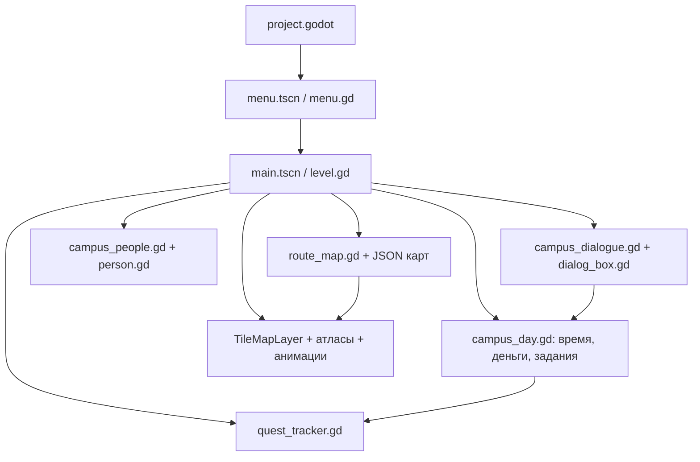
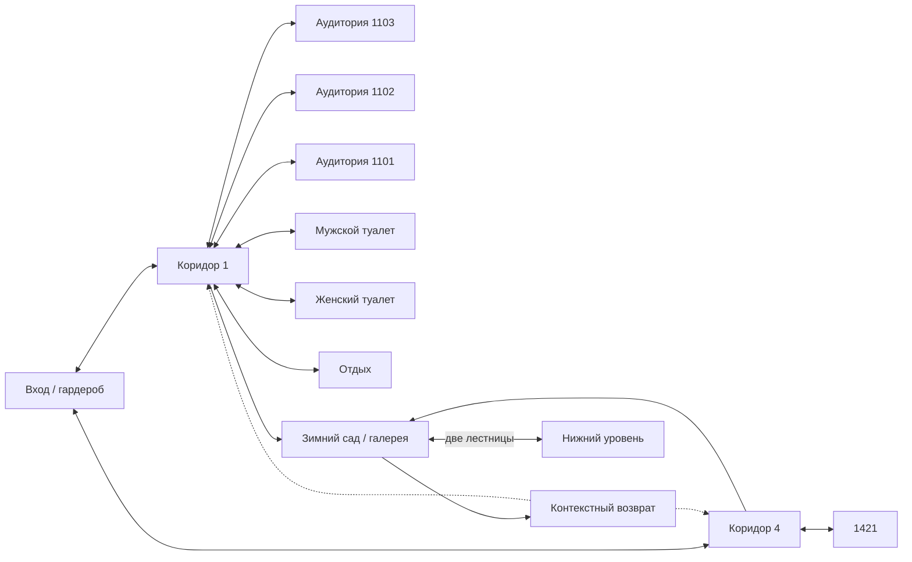

# Архитектура активного прототипа

Срез: 2 ноября 2026. Источник — game/, а не демонстрационные scripts/ исходных пакетов.

## Технологии и запуск

Godot 4.7.2 Standard, GDScript, Compatibility/OpenGL, viewport 1280×720, масштабирование canvas_items, nearest-фильтрация пиксельной графики. Нет внешнего сервера, сетевого банка или требуемого .NET.

menu.gd меняет сцену на main.tscn. Узлы уровня, люди и HUD создаются программно. Сцену corridor.tscn оставили алиасом main.tscn для старого пути. corridor.gd, player.gd, walk_visual.gd не входят в активный цикл.

## Модули и границы

| Модуль | Основной интерфейс/роль |
|---|---|
| level.gd | _ready, _physics_process, change_map, use_exit, begin_talk; связывает системы |
| route_map.gd | initialize, load_map, blocked, exit_at, read_json; геометрия и доступность |
| campus_day.gd | advance, check_attendance, act, tasks, lesson_hint; единственный объект текущего дня |
| campus_dialogue.gd | greeting, options, answer; условные реплики/действия и счётчики встреч |
| campus_people.gd | populate, tick, nearest, blocks_walker; размещения и движение людей |
| person.gd | setup, set_pose, walk, stop, place; отображение листа персонажа |
| character_visual.gd | advance; адаптер игрового перемещения к кадрам героя |
| environment_animation.gd | setup, set_visual, tick; источник 1, циклы и турникеты |
| door_visual.gd | set_open и _process; кадры полосы двери при приближении |
| dialog_box.gd | show_line, show_choices, close; сигналы line_finished/choice_made |
| quest_tracker.gd | refresh; чтение состояния дня и три строки задач |
| fight_club.gd / tyler_visual.gd | Сценарий боя, здоровье, управление, противник и пиксельная отрисовка Тайлера |
| arch_visual / atm_visual / fixture_visual | _draw; геометрия дополнительных объектов |

campus_day — небольшой фиксированный сценарий первого дня, **не универсальная система заданий с редактором/графом квестов**. Реплики по ролям находятся в npc_lines.json; логические действия и переходы флагов — в GDScript.

## Игровой цикл и состояние

В _physics_process уровень сначала проверяет pause/dialog, затем обновляет день, NPC/турникеты/двери, перемещение, кадры героя и подсказку. Действие по E отдаётся переходу, затем банкомату, затем ближайшему NPC.

При разговоре герой останавливается, игровой цикл движения/NPC/часов не выполняется. Пауза реализована флагом level.paused, а не полной остановкой SceneTree: автономные циклы анимированных тайлов и завершающаяся анимация двери могут продолжаться. Список заданий виден в диалоге и скрыт на паузе.

Один объект day принадлежит level.gd. change_map пересоздаёт отображение и население локации, но не day. Возврат в меню уничтожает сцену; новый старт создаёт новый day. Нет файлового сохранения.

В toilet_m создаётся отдельный fight_club. После вводной реплики он блокирует выход и обычные действия, пока бой активен. Игрок и NPC используют те же сеточные ограничения RouteMap; противник подходит, делает видимый замах и бьёт в радиусе. F/пробел/X наносит направленный удар с задержкой, анимация использует поворот и подсветку персонажей. Во время боя часы дня остановлены. При победе включается joined и показывается заключительная реплика; при поражении change_map переносит героя в winter_garden. joined хранится только в памяти уровня. Тайлер рисуется кодом tyler_visual.gd, противник использует существующий student_3. Эти два динамических участника не входят в 83 записи npcs карт.

Флаги: jacket_stored, mentor_met, badge_paid, class_attended, class_late. Дополнительно time_seconds и money. Цена 150 ₽, старт 500 ₽, номерок №27; значения прототипные.

- Приветствие наставника устанавливает mentor_met.
- store_jacket отмечает хранение и выдаёт текст номерка.
- pay_badge требует mentor_met/достаточный баланс; уже оплаченный платёж не списывает средства.
- advance переводит часы с масштабом ×10 и отмечает присутствие при пересечении 13:30 в 1421.
- check_attendance при входе после начала отмечает опоздание.
- wait_class работает из 1421, переводит раннее время в 13:30 и отмечает посещение.
- tasks выдаёт представление трёх строк HUD; строка наставника становится оплатой после знакомства.

## Карты и переходы

Схема показывает связи, а не количество JSON-зон. Всего **25 направленных зон**: две лестницы галереи/низа учитываются отдельно, а один выход зимнего сада подменяет цель по запомненному входу. Поэтому обратный путь корректен из обоих коридоров при нечётном общем количестве зон. Список всех зон/rect/spawn — transitions в [snapshot.json](verification/2026-11-02-fight-club/snapshot.json).

| map id | Размер, клетки | NPC | С путём | Зоны выхода |
|---|---:|---:|---:|---:|
| entrance | 27×16 | 8 | 1 | 2 |
| corridor_1 | 15×24 | 3 | 1 | 8 |
| corridor_4 | 44×3 | 5 | 1 | 3 |
| class_1421 | 12×10 | 10 | 0 | 1 |
| winter_garden | 56×38 | 15 | 3 | 3 |
| winter_garden_lower | 56×38 | 10 | 0 | 2 |
| class_1_a | 12×10 | 10 | 0 | 1 |
| class_1_b | 12×10 | 10 | 0 | 1 |
| class_1_c | 12×10 | 10 | 0 | 1 |
| toilet_m | 6×8 | 0 | 0 | 1 |
| toilet_f | 6×8 | 0 | 0 | 1 |
| lounge_1 | 8×8 | 2 | 0 | 1 |
| **Итого** | не площадь реального здания | **83** | **6** | **25** |

Размер карты — размер сетки с пустотами, не площадь доступного пола. Повторение одних листов в разных помещениях даёт размещения, а не уникальные личности.

Аудитории первого этажа пронумерованы по направлению от входа/гардероба к лестнице №2: 1101 (class_1_c), 1102 (class_1_b), 1103 (class_1_a). Эти номера совпадают на табличках, в названиях помещений и подсказках переходов. Номера четвёртого этажа и квестовая аудитория 1421 сохранены.

## Данные JSON

| Файл/поле | Смысл |
|---|---|
| route_map.gd / MAP_IDS | Явный список активных карт |
| <id>.json / id,title,size,rows,spawn | Идентификатор, сетка, начальная клетка |
| floor, floor_regions | Базовый пол и прямоугольные области другого покрытия |
| walls, props | Объекты {x,y,tile}; optional cutaway скрывает переднюю стену |
| under | Нижняя карта для обзорной отрисовки |
| exits | {rect:[x,y,w,h],to,spawn,label}; remember_return/return_spawn и contextual_return задают возвраты |
| doors, arches, atms, fixtures | Дополнительные визуальные/интерактивные объекты |
| npcs | {who,x,y,facing,pose}; optional path,solid,lift |
| labels, portal_markers | Подписи и указатели переходов |
| legend.json | Символы rows → floor/walkable/elevation |
| tiles.json | ID → atlas/source/solid_edge/y_sort_origin |
| characters.json | Персонажи, листы, имена и портреты |
| anim.json | Текстура, циклы и полосы открытия |
| npc_lines.json | Приветствия, темы и ответы ролей |
| npcs_example.json | Исторический пример расстановки, не runtime-источник |

При добавлении карты недостаточно положить JSON: нужно включить её в MAP_IDS, добавить достижимые переходы и проверить спавны. Квестовый класс сейчас задан константой CLASSROOM = class_1421.

labels рисуются на всех картах через level._add_map_sign: синяя табличка, светлый текст, позиция x/y и необязательный offset. Номера 1413/1417/1421/1425/1429 расположены над дверями четвёртого этажа. Первый коридор дополнительно использует portal_markers для отдельных комнат. Обе зоны зимнего сада имеют ID winter_garden / winter_garden_lower.

## Проекция, движение и коллизии

Изометрия: экранный x = (grid.x − grid.y) × 32; экранный y = (grid.x + grid.y − 1) × 16, плюс origin. Центр персонажа на сетке — x+0.5,y+0.5. Ввод переводится обратно в сетку так, чтобы вверх на стике означало вверх на экране.

Коллизии реализованы **проверками данных**, а не CharacterBody2D/физическими телами для каждого предмета. blocked проверяет центр ступней и четыре смещения радиуса 0.13 клетки. У границ стен margin 0.30; учитываются walkable, solid_edge и клетки статичных NPC. Перемещение по x/y проверяется отдельно, что даёт скольжение вдоль препятствий.

Скорость героя 4 клетки/с; маршрутов NPC — 1.5. Идущие NPC не занимают статичную клетку: останавливаются перед игроком на расстоянии 0.65, а игрок дополнительно проверяет дистанцию 0.42. Полноценного поиска пути, расписания NPC и системы толпы нет; заданы проверенные полилинии.

## Графика и интерфейс

TileMapLayer пола, отдельных поверхностей и Y-сортируемых предметов. Нижний мир виден со сдвигом 72 px; его NPC в этом обзорном представлении не ходят. Поднятые покрытия лежат под актёрами, без повторяющихся передних граней.

TileSet source 0: 136 статических тайлов. source 1 создаётся environment_animation.gd из anim.json: 10 циклов и 5 полос; в общем каталоге 166 записей. Двери читают четыре кадра своей полосы напрямую, открываются при приближении; переход всё равно по действию. Турникеты не проверяют пропуск.

Листы персонажей 320×960, кадр 64×96, ступни (32,88), 8 направлений × idle/4 шага, 8 fps; строки sit/type. Портреты 128×128, отображаются увеличенными.

Диалог печатает 45 символов/с; длинные тексты делятся по измеренной высоте шрифта на страницы. Сигнал окончания выдаётся только после последней страницы. Банк использует тот же UI без портрета. quest_tracker показывает часы/деньги/задачи и обновляет текст при изменении представления.

## Подтверждения и границы

[VALIDATION.md](VALIDATION.md) описывает проверки и ручные сценарии. Не реализованы: дисковые сохранения, общее расписание/инвентарь/магазин, полноценное занятие, сервер, профили экспорта. Старые .gd и исходные демо сохранены для истории, их присутствие не доказывает использование.

